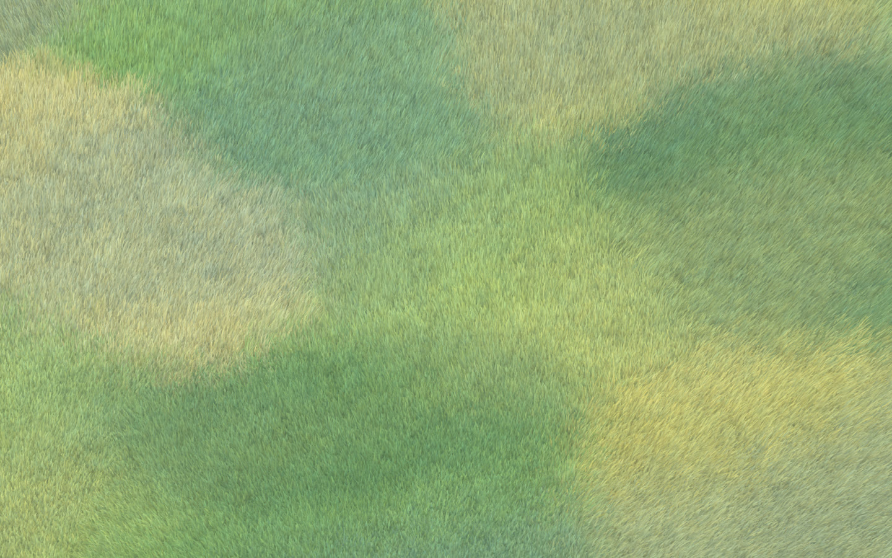
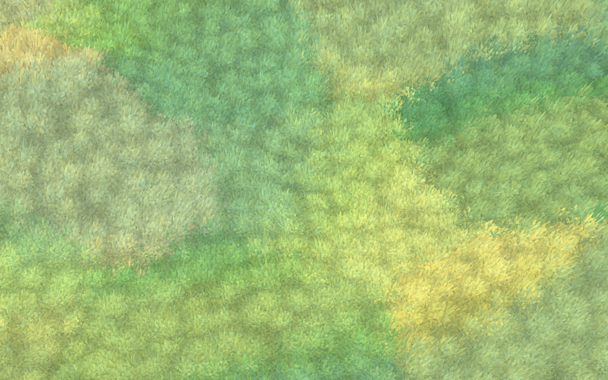
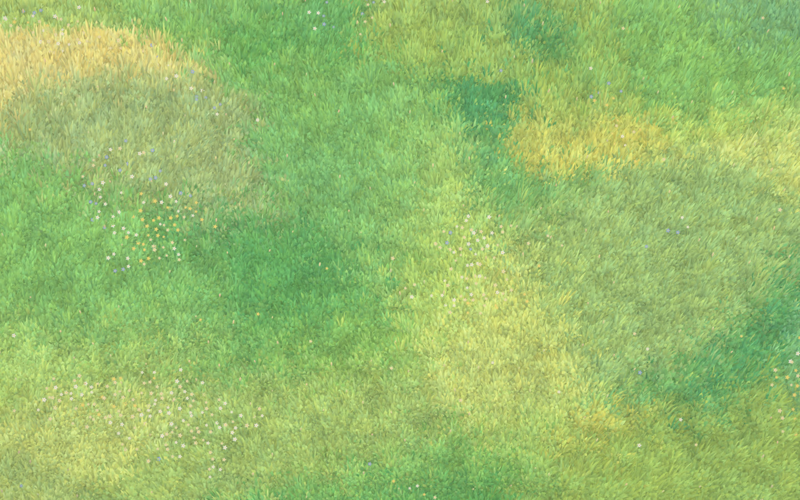

# WIND STUDY: a case study

## Concept

You can't see wind. You see what it does: a field going pale in a long moving band. WIND STUDY hands you that force directly. You draw a line, the line disappears, and the only remaining evidence is the grass.

## Artistic direction

The target was a contemporary aerial landscape illustration: gouache, feathered edges, soft tonal masses. The reference images named in the brief were not on disk, so the work follows its written description.

The composition is hand-placed. Sixteen field patches each have a position, a pigment, a nap direction and a grass height. Noise only feathers those decisions, which is why the picture reads as composed rather than generated. Shadows are glazes over the pigment, so a golden field stays golden in the shade.

## Grass rendering

**Screen-distributed tufts.** The camera never moves, so tufts are scattered evenly over the *screen* with a low-discrepancy sequence. That removes the need for LOD and with it LOD rings. Any prefix of the sequence still covers the frame evenly, so quality can drop by drawing fewer tufts with no visible seam.

**Fluff comes from three scales.** Each tuft is a dome of six strands fanning outward. Tufts gather on soft mounds about a world unit across and fall off their crowns, darker in the creases. Dense short underfur fills the gaps, with sparse tall wisps above.

Mounds were the turning point. Compare the first frame, which read as CG turf with needle blades:

with the next, which read as paint but too coarse, like shrubs:

and the final balance:

**Soft edges without sorting.** Strands use alpha-to-coverage on a 4× MSAA target. A slight three-tap softening and a stationary paper grain finish the frame.

## The wind field

Gestures don't animate grass. They push air.

- **Gesture.** Pointer input goes through a speed-adaptive filter and is resampled by arc length. A *gust* owns that path and a *head* that runs along it no faster than a set speed. While the pointer is down the head chases it, so slow strokes respond at once. A fast flick outruns it, and the head catches up over the next half-second, which is why even a flick travels.
- **Field.** A small semi-Lagrangian fluid on a 181×124 grid, at a fixed 60 Hz. The head pushes along the local tangent, with a soft onset ahead and a fading tail behind. After release it runs on past the end of the stroke and dies away.
- **Spirals.** A stroke that turns far enough around a compact centre also adds a decaying rotational force.
- **Propagation** comes from self-advection plus the moving head.
- **Continuity.** Raw grids are read through a C² cubic B-spline into half-float targets, blended between the last two steps, so strands sample a smooth field at any frame rate.
- **Ambient breeze.** Slow, patchy, non-looping noise is added to the air before the grass reads it.

## Motion dynamics

Inertia lives on the same grid: each cell holds two damped springs. Tall soft strands read the slow one (0.82 Hz, ζ 0.5) and short stiff strands the quick one (1.55 Hz, ζ 0.62). Blending them per strand gives individual timing with no per-blade CPU work and no loss of spatial continuity. A slowly fading energy term drives tip flutter, so tips keep trembling after the gust has gone.

A strand is a constant-curvature arc. Its root is exactly anchored and its length exactly preserved, so it can only lean. An E2E test runs the actual GLSL through transform feedback and compares it with the tested TypeScript formula.

## Technical challenges, as they actually happened

**The idle field hid the gust.** A pixel motion map showed 36% of the frame changing with no gust at all, because the breeze and base flutter were too strong. Quieting them gave gusts something still to contrast against.

**Fluid physics fought the art.** The same map showed the strongest motion in two lobes *beside* the stroke, not along it: return flow from the pressure solve. Applying the correction only partly, about 16%, keeps a soft curl at the edges and lets a gust stay a ribbon. This is deliberately not a correct fluid.

**Slow strokes blew harder than fast ones.** Force per unit time piled up wherever the head dwelt. Force is now normalised per unit of path.

**Avoiding water.** Terrain height never moves. All movement is strands leaning, and the visible band comes from their attitude to the light: leaning toward the sun lifts them, leaning away cools them, and a bowed strand shows a paler flank.

**Avoiding an overlay.** An early whirl pushed the colour to lime, reading as a tint rather than grass. Shading was pulled back until the deformation carried it.

**Performance was not where expected.** Cutting vertices helped less than predicted. Measuring with almost no grass showed 14 ms a frame at DPR 2, all per-pixel: procedural paper noise, and the ground drawn under everything. Baking the grain into a small texture, drawing the ground last and moving cloud shadow into the field texture recovered it.

## Performance

Measured on an Apple M2 Pro (19-core GPU) in Chromium via Metal, at 2880×1800 with 360,000 strands and gusts blowing, system load around 7:

| | median | p90 | p99 |
| --- | --- | --- | --- |
| Frame cost with readback forcing the GPU to finish | 14.8 ms | 15.4 ms | 24.4 ms |
| Same, at 1440×900 | 12.1 ms | 12.4 ms | 22.1 ms |
| Headed window, `requestAnimationFrame` interval | 8.3 ms | 8.4 ms | 9.3 ms |

The wind simulation step costs about 3.3 ms on the main thread. All grass is one instanced draw call.

Quality adapts only when frames are really being missed: resolution first, then strand count, with strands widening to keep coverage. Adaptive quality was tested by test hook, not on slow hardware. **Performance on a real phone or an integrated GPU has not been measured.** Touch and framing were tested in Chromium's phone emulation only.

## Originality

All code and artwork are original and procedural. No image or texture assets are used. Three.js, React and Inter Tight are third-party.

## Future work

Not implemented: pinned persistent wind paths, wind-carried seed fluff, birds or butterflies, moving the simulation to a worker or the GPU, a debug vector overlay in the UI.
