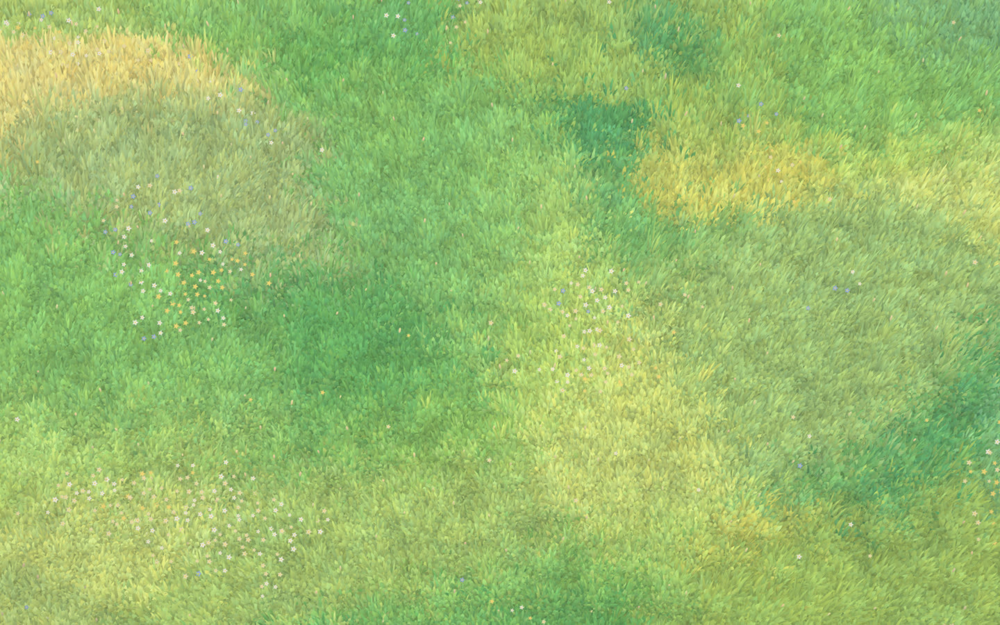
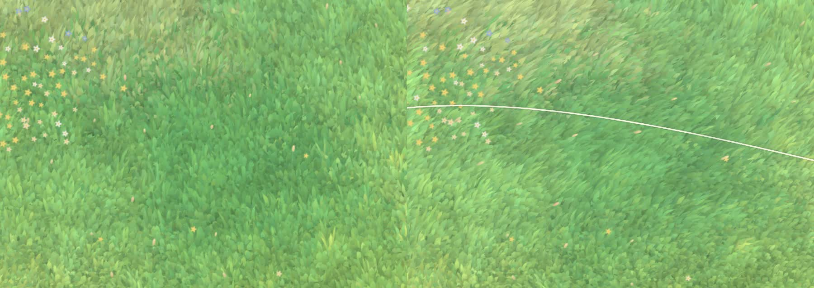

# WIND STUDY — Draw the Invisible

Draw a line across a hand-painted meadow. The line fades, but its force stays: a wave of wind travels through 360,000 soft strands of grass, leans them over, and lets them settle.



[Hero film (20 s)](docs/media/hero.mp4) · [Case study](CASE_STUDY.md)

| At rest vs mid-gust, same patch of grass |
| --- |
|  |

## Run it

```bash
npm install
npm run dev        # http://localhost:5428
```

```bash
npm run build && npm run preview   # production build on http://localhost:4428
```

## Controls

| | |
| --- | --- |
| Draw | Press and drag. Long line: rolling gust. Flick: short burst. Spiral: whirl. Tap: a small breath. |
| Breeze / Gust / Gale | Wind strength for the next stroke |
| Undo (Z) | Calms the latest gust still blowing. It stops pushing and the air along its path stills; time is not reversed. Disabled once nothing is blowing. |
| Clear (C) | Calms all drawn wind. The ambient breeze stays. |
| Pause (Space) | Freezes wind, grass and clouds |
| Reset (R) | Restores the starting scene and defaults |
| Capture (S) | Saves a PNG without the interface |
| Record | Saves a video of the canvas (MP4 or WebM, depending on the browser) |
| Hide (H) | Hides the interface |
| 1, 2, 3, 4 | A sweep, spiral, flick or crossing gusts, without a pointer |

`prefers-reduced-motion` turns the breeze and gust strength down.

## How it works

```
pointer ─► smoothing ─► Gust (path + travelling head)
                            │ pushes along its tangent
                            ▼
              WindField: small 2D fluid, 181×124, fixed 60 Hz ◄─ ambient breeze
                            │ total wind
                            ▼
              GrassResponse: two damped springs per cell, flutter energy
                            │ RGBA32F upload
                            ▼
              WindTextures: cubic B-spline into half-float targets
                            │ one instanced draw call
                            ▼
              Vertex shader: constant-curvature arc per strand
```

| Path | What it holds |
| --- | --- |
| `src/wind` | Fluid, ambient breeze, gusts, springs, GPU upload, ready-made patterns |
| `src/grass` | Tuft generation, strand shape and shader, flowers and seed heads, cloud shadows |
| `src/scene` | Terrain, the baked painting, camera framing, ground |
| `src/interaction` | Pointer smoothing, stroke geometry, the ink line |
| `src/engine` | MSAA target and paper-finish compositor |
| `src/app`, `src/ui`, `src/state` | Orchestration, interface, store |
| `src/capture` | Still and video export |

## Tests

```bash
npm run typecheck && npm run lint
npm test                                            # 34 numeric tests
npm run test:e2e                                    # 32 tests in real Chromium, real GPU
E2E_PROD=1 npm run test:e2e                         # the same, against the production build
npx playwright test -c playwright.cross.config.ts   # WebKit and Firefox smoke test
```

The visual snapshots in `tests/e2e/visual.spec.ts-snapshots` were made on an Apple M2 Pro. On other GPUs, regenerate them with `--update-snapshots`.

QA scripts, which need the dev server running: `scripts/film.mjs` (offline video through the real renderer), `diff.mjs` (motion map on real pixels), `fieldmap.mjs`, `probe.mjs`, `perf.mjs`, `raf.mjs`, `ui.mjs`.

## Deploy

Static site; `vercel.json` is included. The project has not been deployed.

```bash
npx vercel --prod
```

## Credits

All code and artwork are original and procedural: no image, texture or model files are used. Libraries: [three.js](https://threejs.org) (MIT), React (MIT), Inter Tight via Fontsource (OFL). The illustrated aerial-landscape references described in the brief were inspiration only and are not included. Code is MIT licensed.
